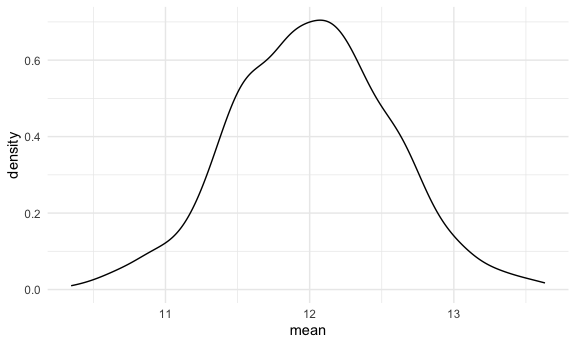
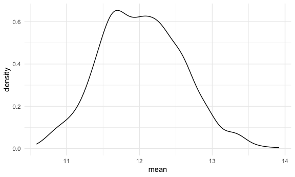
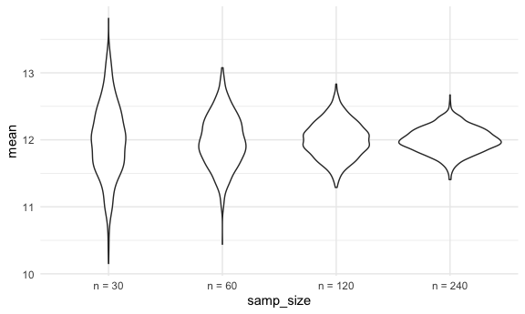

Simulation
================

``` r
library(tidyverse)

source("source/sim_mean_sd.R")

set.seed(1236)
```

## Mean and SD

Can we check CLT using simulations

``` r
sim_mean_sd(n_obs = 30)
```

    ## # A tibble: 1 × 2
    ##    mean    sd
    ##   <dbl> <dbl>
    ## 1  12.5  2.60

let’s do this but keep track of results

``` r
output = vector("list", length = 1000)

for (i in 1:1000) {
  
  output[[i]] = sim_mean_sd(n_obs = 30)
  
}
```

inspect results

``` r
output |> 
  bind_rows() |> 
  summarize(
    emp_m = mean(mean), 
    emp_se = sd(mean)
  )
```

    ## # A tibble: 1 × 2
    ##   emp_m emp_se
    ##   <dbl>  <dbl>
    ## 1  12.0  0.551

``` r
output |> 
  bind_rows() |> 
  ggplot(aes(x = mean)) + 
  geom_density()
```



let’s do this using tibbles and map instead!

``` r
sim_results_df = 
  tibble(
    samp_size = rep(30, 1000)
  ) |> 
  mutate(
    est_df = map(samp_size, sim_mean_sd)
  ) |> 
  unnest(est_df)
```

look at results

``` r
sim_results_df |> 
  ggplot(aes(x = mean)) +
  geom_density()
```



## change `n`

``` r
sim_results_df = 
  expand_grid(
    samp_size = c(30, 60, 120, 240), 
    iter = 1:1000
  ) |> 
  mutate(
    est_df = map(samp_size, sim_mean_sd)
  ) |> 
  unnest(est_df)
```

``` r
sim_results_df |> 
  mutate(
    samp_size = str_c("n = ", samp_size),
    samp_size = fct_inorder(samp_size)
  ) |> 
  ggplot(aes(x = samp_size, y = mean)) +
  geom_violin()
```



look at the numbers

``` r
sim_results_df |> 
  mutate(
    samp_size = str_c("n = ", samp_size),
    samp_size = fct_inorder(samp_size)
  ) |> 
  group_by(samp_size) |> 
  summarize(
    emp_m = mean(mean), 
    emp_se = sd(mean)
  )
```

    ## # A tibble: 4 × 3
    ##   samp_size emp_m emp_se
    ##   <fct>     <dbl>  <dbl>
    ## 1 n = 30     12.0  0.549
    ## 2 n = 60     12.0  0.391
    ## 3 n = 120    12.0  0.267
    ## 4 n = 240    12.0  0.187
